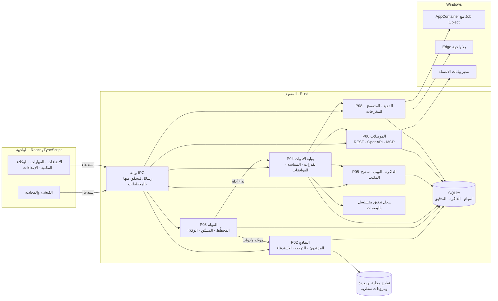
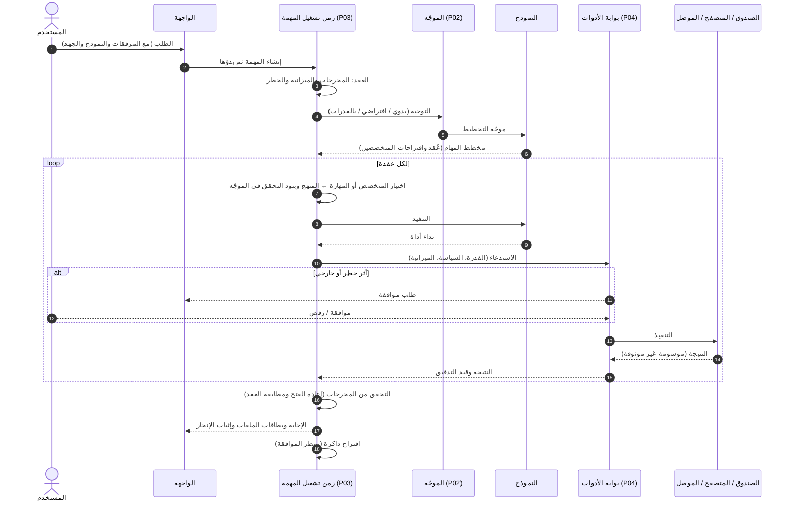
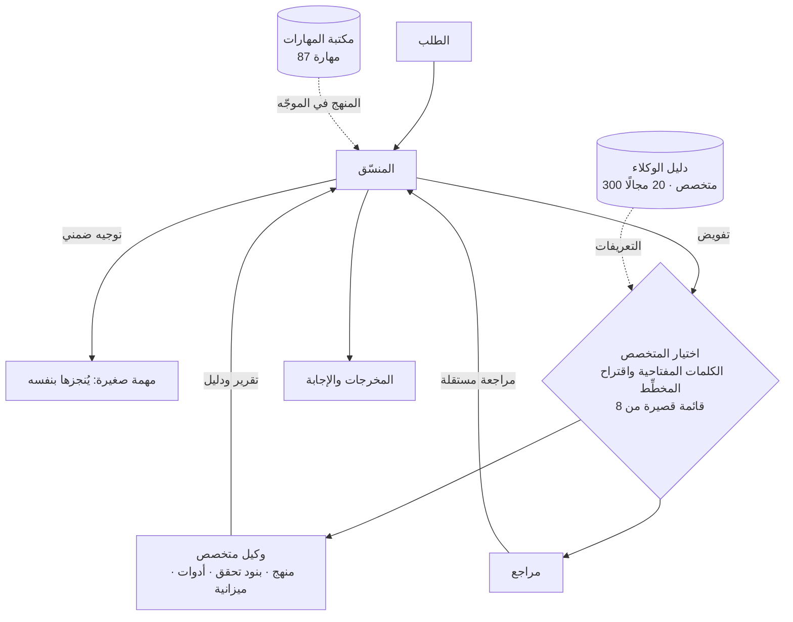
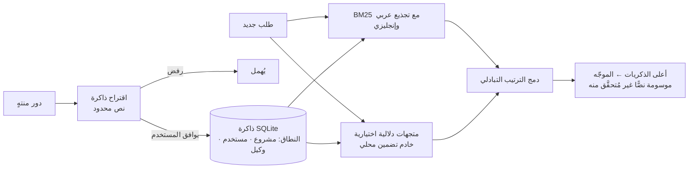

<div dir="rtl">

# POLARIS

[English](README.md) · **العربية**

POLARIS بيئة سطح مكتب وكيلية تعمل محليًا أولًا على Windows. ينجز فيها وكلاء الذكاء الاصطناعي
عملًا حقيقيًا على جهازك: يخطّطون للمهمة، ويكتبون الشيفرة ويشغّلونها في صندوق معزول، ويقودون
متصفحًا حقيقيًا، ويستدعون خدماتك، ويسلّمون مستندات وجداول وعروضًا ومواقع مُتحقَّقًا منها. وكل فعل
يمرّ ببوابة سياسة واحدة، وكل ما فيه خطر ينتظر موافقتك، وكل نتيجة تحمل الدليل الذي بُنيت عليه.

> **الحالة: ما قبل الإصدار، خاص.** يعمل على Windows 11 وحده، والملف التنفيذي غير موقّع رقميًا.
> أرقام الجاهزية في هذا المستودع مقيسة لا مقدّرة، وما لم يُقَس مكتوب عليه ذلك.

---

## المحتويات

1. [القدرات](#القدرات)
2. [متطلبات التشغيل](#متطلبات-التشغيل)
3. [المكتبات وبيئات التشغيل](#المكتبات-وبيئات-التشغيل)
4. [البناء والتشغيل](#البناء-والتشغيل)
5. [المعمارية](#المعمارية)
6. [سير العمل من الطرف إلى الطرف](#سير-العمل-من-الطرف-إلى-الطرف)
7. [الوكلاء](#الوكلاء)
8. [الذاكرة](#الذاكرة)
9. [الأدوات والمهارات والموصلات](#الأدوات-والمهارات-والموصلات)
10. [نموذج الأمان](#نموذج-الأمان)
11. [الاختبارات](#الاختبارات)
12. [بنية المستودع](#بنية-المستودع)
13. [الترخيص](#الترخيص)

---

## القدرات

| المجال | ما يفعله |
|---|---|
| المهام | الطلب يصير مهمة: مخطط مهام، وعقد مخرجات، وميزانية، وإثبات إنجاز في النهاية |
| النماذج | محلية (خادم llama.cpp وOllama وLM Studio وأي خادم محلي متوافق مع OpenAI)، وبعيدة بمفتاحك (OpenAI وAnthropic وGoogle وGroq وOpenRouter وxAI…)، وأداتا Codex وClaude السطريتان بدخولهما الخاص |
| التوجيه | نموذج يدوي، أو افتراضي المشروع أو المستخدم، أو مطابقة القدرات؛ ومستوى جهد التفكير لكل مزوّد |
| الوكلاء | منسّق و300 وكيل متخصص في 20 مجالًا، لكلٍّ منهجه وبنود تحققه وأدواته وميزانيته |
| المهارات | 87 مهارة تعليمات (محتوى، بيانات، تصميم، وسائط، برمجة، أتمتة…) تدخل الموجّه حين يحتاجها الطلب |
| التنفيذ | PowerShell وPython في صندوق AppContainer مع Job Object؛ الشبكة مغلقة ما لم توافق |
| المتصفح | Chromium حقيقي (Microsoft Edge) بلا واجهة مع JavaScript؛ كل طلب يمرّ بسياسة التصفح في المضيف |
| الملفات | Word وExcel (مع الرسوم) وPowerPoint وPDF (بالعربية أيضًا) وHTML وMarkdown وCSV، وكلها يُعاد فتحها والتحقق منها بعد الكتابة |
| الموصلات | كتالوج إضافات من 208 بطاقة؛ و44 إعدادًا جاهزًا للقراءة (GitHub وGmail وتقويم Google وDrive وOutlook وStripe وAirtable وHubSpot وCloudflare وCoinGecko…)، وREST عام، واستيراد OpenAPI، وخوادم MCP بعيدة |
| الذاكرة | ذاكرة للمشروع والمستخدم والوكيل: BM25 مع تجذيع عربي وإنجليزي ودمج الترتيب التبادلي (RRF)، ومتجهات دلالية اختيارية، ولا يُحفظ شيء قبل موافقتك |
| الأتمتة | مهام مجدولة (لا تُوافَق مسبقًا أبدًا)، وتحكّم بسطح المكتب في النوافذ التي تمنحها |
| اللغات | العربية والإنجليزية، من اليمين إلى اليسار ومن اليسار إلى اليمين في كل مكان |

## متطلبات التشغيل

| العنصر | الإصدار |
|---|---|
| نظام التشغيل | Windows 11 x64 (قد يعمل Windows 10 22H2؛ لم يُختبر) |
| WebView2 Runtime | الإصدار الدائم التحديث (مثبّت مع Windows 11) |
| أدوات Rust | 1.89 فأحدث (الهدف `x86_64-pc-windows-msvc`) |
| Visual Studio Build Tools | 2022 مع حزمة «Desktop development with C++» |
| Node.js | 22 LTS فأحدث (اختُبر 24) |
| Python | 3.11 فأحدث في PATH، لصندوق تنفيذ الشيفرة (اختياري) |
| Microsoft Edge | أي إصدار حالي، لأداة المتصفح الحقيقي |
| نموذج | واحد على الأقل: خادم محلي متوافق مع OpenAI (مثل `llama-server` على `127.0.0.1:8080`)، أو Ollama، أو LM Studio، أو مفتاح API بعيد، أو أداة Codex أو Claude السطرية |
| العتاد | 16 غيغابايت ذاكرة على الأقل؛ وكرت شاشة بذاكرة 12 غيغابايت فأكثر للنماذج المحلية المريحة |

## المكتبات وبيئات التشغيل

**المضيف (Rust، `desktop/host`):** مساحة عمل من ست حزم: `core` (كل منطق المجال، بلا واجهة)،
و`app` (غلاف Tauri الرقيق)، و`providers` (محوّلات النماذج)، و`win` (صندوق Windows وواجهات سطح
المكتب)، و`maint` و`harness` (الصيانة والقياس).

| المكتبة | الاستخدام |
|---|---|
| `tauri` 2 | غلاف سطح المكتب، وIPC، والبروتوكول المخصص |
| `rusqlite` 0.42 (`bundled`) | قاعدة البيانات المحلية الوحيدة (المهام والذاكرة والتدقيق والموصلات) |
| `serde` و`serde_json` | العقود وحمولات IPC |
| `boon` 0.6 | التحقق من كل رسالة IPC مقابل مخطط JSON |
| `sha2` 0.10 | بصمات المحتوى وسجل التدقيق المتسلسل بالبصمات |
| `ed25519-dalek` 2 | التحقق من توقيع بيان التحديث |
| `url` 2.5 | تحليل عناوين الويب لسياسة التصفح |
| `miniz_oxide` 0.8 | ملفات OOXML (docx/xlsx/pptx) وتدفقات PDF |
| `base64` 0.22 و`getrandom` 0.3 | لقطات DevTools؛ و`state` وPKCE في OAuth |
| `windows-sys` 0.61 | AppContainer وJob Objects وUI Automation والتحكم بالعمليات |

**الواجهة (TypeScript، `desktop/renderer`)**

| المكتبة | الإصدار |
|---|---|
| React / React DOM | 18.3.1 |
| `@tauri-apps/api` | 2.9.0 |
| `ajv` و`ajv-formats` | 8.20.0 / 3.0.1 (التحقق من العقود في الواجهة) |
| Vite و`@vitejs/plugin-react` | 6.4.6 / 4.3.4 |
| TypeScript | 5.7.3 |
| `jsdom` | 25.0.1 (اختبارات الواجهة) |

**العقود (`contracts`):** مخططات JSON لكل طلب ونتيجة IPC وحدث تدقيق، مع أنواع TypeScript مولّدة
و678 اختبارًا بأمثلة إيجابية وسلبية. **بيئة المرجع (`runtime`):** تنفيذ TypeScript مرجعي لآلة حالات
المهمة وقواعد الأدلة.

## البناء والتشغيل

<div dir="ltr">

```powershell
# 1. الواجهة
cd desktop/renderer
npm ci
npm run build

# 2. الملف التنفيذي (البناء الوحيد المعتمد للإصدار)
cd ../host
cargo build --release -p polaris-host --features custom-protocol

# 3. التشغيل
./target/release/polaris-desktop.exe
```

</div>

ثم افتح **الإعدادات ← النماذج**، وأضف مزوّدًا، واختر نموذجًا من القائمة أعلى المحادثة.

الاختبارات:

<div dir="ltr">

```powershell
cd desktop/host;     cargo test --workspace
cd desktop/renderer; npm test
cd contracts;        npm run verify
```

</div>

## المعمارية



قواعد تسري في كل مكان:

- **بوابة واحدة.** لا وكيل ولا مهارة ولا موصل يلمس النظام مباشرة؛ كل نداء أداة يمرّ بفحص القدرة
  والسياسة والميزانية والموافقة في `P04`.
- **العقود أولًا.** كل رسالة IPC يُتحقَّق منها بمخطط JSON في الطرفين، وأي حقل يشبه سرًّا يرفضه
  العقد نفسه.
- **البيانات ليست تعليمات أبدًا.** محتوى الملفات والصفحات ومخرجات الأدوات ورسائل الوكلاء الآخرين
  موسومة بأنها غير موثوقة، ولا يمكنها توسيع الصلاحيات.
- **الدليل قبل الادعاء.** لا تُعلَن المهمة «مكتملة» حتى تكون مخرجاتها موجودة، ويُعاد فتحها، وتطابق
  العقد.

## سير العمل من الطرف إلى الطرف



مسارات الإخفاق حالات صريحة لا صامتة: نفاد رصيد المزوّد (`PROVIDER_CREDIT_EXHAUSTED` بالأرقام
والحل)، وتحديد المعدّل (ينتظر مهلة `retry-after` التي يحددها المزوّد)، وسياق أكبر من اللازم (يُنصَّف
سقف المخرجات ويُعاد)، والرفض المتكرر، والمدخلات المعبوث بها، والمخرجات الناقصة.

## الوكلاء



- **الأدوار** (مخطِّط، بانٍ، مراجع) تصف موقع الوكيل في سير العمل، و**المتخصصون** يضيفون منهج
  المجال وبنود تحققه. ولا يمنح أيٌّ منهما سلطة: الأدوات من قائمة الوكيل نفسه، وكل نداء يمرّ بالبوابة.
- لكل متخصص تعريف مجمّد: قائمة أدوات من ملف مجاله، وميزانية أدوار ونداءات، ونطاق ذاكرة خاص، وعقد
  تقرير (ملخّص وقسم لكل بند تحقق) يُصحَّح قبل أن يقبله المنسّق.
- النموذج لا يختار هويته: يقترح معرّفًا من قائمة قصيرة بناها زمن التشغيل، وزمن التشغيل يتحقق منه.

## الذاكرة



- لا يُحفظ شيء بلا موافقة، والملاحظات المحفوظة موسومة «غير مُتحقَّق منها» ولا تُعامل حقيقةً.
- كل سياق (مشروع، مستخدم، وكيل) يسترجع نطاقه وحده؛ لا تسرّب بين المشاريع.
- القياس على المجموعة المحجوزة: الدقة من 0.511 إلى 0.794، والاستدعاء من 0.750 إلى 0.833،
  وصفر تسرّب بين النطاقات.

## الأدوات والمهارات والموصلات

- **الأدوات** واصفات مسجّلة بآثار معلنة (`READ_LOCAL` و`NETWORK_EGRESS` و`PROCESS_EXECUTION`…)
  وصنف خطر ومخطط مدخلات. والأوامر تُصنَّف قبل تشغيلها (شبكة، تثبيت حزم، إعدادات نظام، رفع صلاحيات).
- **المهارات** حزم تعليمات: منهج المهارة وبنود تحققها يدخلان الموجّه حين يطابق التوجيه الطلب،
  وتعطيل المهارة يُخرجها من التوجيه. ملف واحد (`desktop/renderer/src/p04/skill-library.json`) يغذّي
  المعرض والمضيف معًا.
- **الموصلات** تعمل عبر بوابة واحدة: حدود المعدّل، وسقوف حجم الرد، والأسرار في مدير بيانات اعتماد
  Windows (لا في قاعدة البيانات ولا في الواجهة)، وعمليات قراءة فقط للإعدادات الجاهزة. مخرجات خوادم
  MCP غير موثوقة دائمًا، وكل نداء بعيد يحتاج موافقة.

## نموذج الأمان

| التهديد | الضابط |
|---|---|
| حقن التعليمات من الملفات أو الصفحات أو الأدوات | المحتوى موسوم غير موثوق، ولا يمنح أدوات ولا موافقات؛ التعليمات من المستخدم وحده |
| القراءة خارج مساحة العمل | وسيط المسارات يرفض، وتُرفض وصلات Windows (junctions) التي تخرج من الجذر |
| الأفعال الهدّامة أو الخارجية | موافقة إلزامية؛ والرفض المتكرر يوقف المهمة |
| تنفيذ الشيفرة | AppContainer مع Job Object؛ والشبكة مرفوضة بلا قدرة |
| الأسرار | مدير بيانات الاعتماد وحده؛ والعقود ترفض الحقول التي تشبه الأسرار؛ والسجلات تنقّح المفاتيح |
| التسريب عبر المتصفح | كل طلب يمرّ بسياسة التصفح؛ والنطاقات الخاصة والمحلية محجوبة افتراضيًا |
| العبث | المدخلات المحمية مبصومة، والملف المتغيّر يُسقط النتيجة، وسجل التدقيق متسلسل بالبصمات |
| سلسلة التوريد | تبعيات مثبّتة الإصدار؛ و`cargo audit` و`npm audit` نظيفان عند الإصدار |

## الاختبارات

| المجموعة | النتيجة (2026-11-13) |
|---|---|
| `cargo test --workspace` | 1564 ناجح · 0 فاشل · 22 متجاوز (قياسات بنماذج حقيقية) |
| الواجهة (`npm test`) | 250 ناجح · 0 فاشل |
| العقود (`npm run verify`) | 678 ناجح · 0 فاشل |
| `cargo clippy --workspace --all-targets` | 0 تحذير |
| `cargo audit` و`npm audit` | 0 ثغرة |

## بنية المستودع

<div dir="ltr">

```
contracts/          مخططات JSON والأنواع المولّدة والأمثلة واختبارات العقود
desktop/host/       مساحة عمل Rust: core وapp وproviders وwin وmaint وharness
desktop/renderer/   واجهة React والترجمة (ar/en) واختبارات الواجهة
runtime/            بيئة TypeScript المرجعية للمهام والأدلة واختباراتها
tests/              اختبارات العزل والهيكل العامل
tools/              المولّدات وسكربتات المطابقة التي تستعملها الاختبارات
docs/               قرارات المعمارية والمعمارية والأدلة العامة (ar/en)
```

</div>

## الترخيص

AGPL-3.0-or-later. انظر [LICENSE](LICENSE) و[NOTICE](NOTICE) و[THIRD_PARTY_NOTICES.md](THIRD_PARTY_NOTICES.md)
و[TRADEMARK.md](TRADEMARK.md). أسماء الخدمات في كتالوج الإضافات علامات تجارية لأصحابها، ولا تعني أي
شراكة.

</div>
