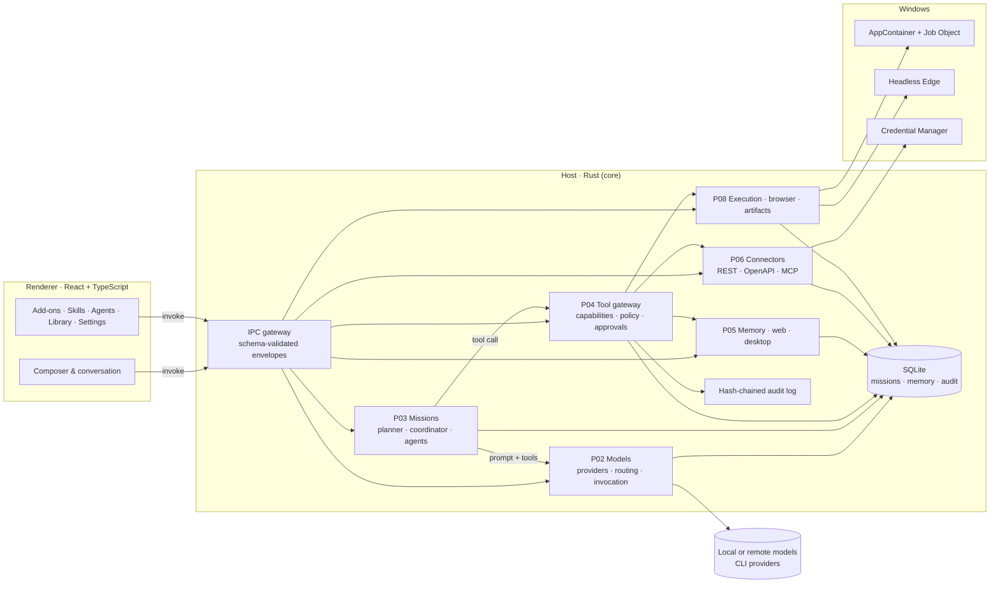
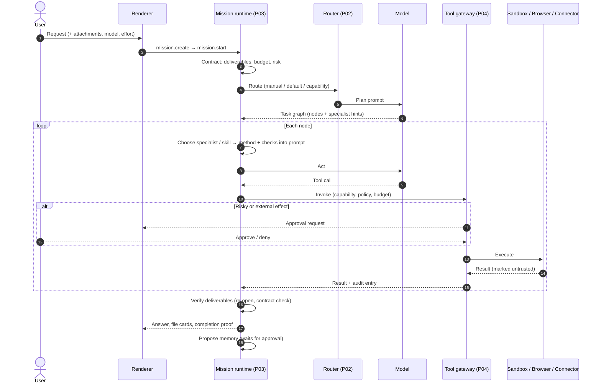
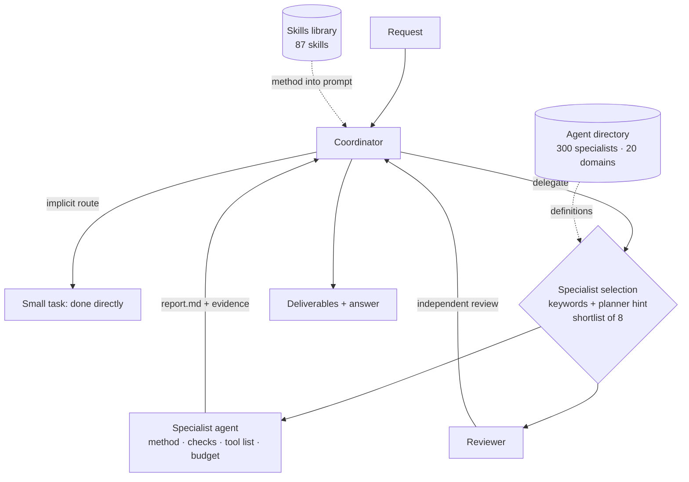
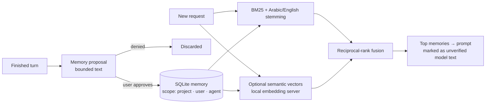

# POLARIS

**English** · [العربية](README.ar.md)

POLARIS is a local-first agentic desktop environment for Windows. AI agents do real work on
your machine — plan a mission, write and run code in a sandbox, drive a real browser, call your
services, and deliver verified documents, spreadsheets, decks and sites — while every action
passes one policy gateway, anything risky waits for your approval, and every result carries the
evidence it was built from.

> **Status: pre-release, private.** Windows 11 only. The executable is not code-signed.
> Readiness figures in this repository are measured, not estimated; anything not measured is
> marked as such.

---

## Contents

1. [Capabilities](#capabilities)
2. [Requirements](#requirements)
3. [Libraries and runtimes](#libraries-and-runtimes)
4. [Build and run](#build-and-run)
5. [Architecture](#architecture)
6. [End-to-end workflow](#end-to-end-workflow)
7. [Agents](#agents)
8. [Memory](#memory)
9. [Tools, skills and connectors](#tools-skills-and-connectors)
10. [Security model](#security-model)
11. [Testing](#testing)
12. [Repository layout](#repository-layout)
13. [License](#license)

---

## Capabilities

| Area | What it does |
|---|---|
| Missions | A request becomes a mission: a task graph, a contract of deliverables, a budget, and a final proof |
| Models | Local (llama.cpp server, Ollama, LM Studio, any OpenAI-compatible loopback server), remote with your own key (OpenAI, Anthropic, Google, Groq, OpenRouter, xAI…), and the Codex / Claude CLIs with their own sign-in |
| Routing | Manual model, project or user default, or capability match; a reasoning-effort control for every provider |
| Agents | A coordinator plus 300 specialist agents in 20 domains, each with its own method, checks, tools and budget |
| Skills | 87 instruction skills (content, data, design, media, programming, automation…) routed into the prompt when a request needs them |
| Execution | Windows PowerShell and Python in an AppContainer + Job Object sandbox; network off unless approved |
| Browser | A real headless Chromium (Microsoft Edge) with JavaScript; every request is checked by the host's navigation policy |
| Files | Word, Excel (with charts), PowerPoint, PDF (Arabic included), HTML, Markdown, CSV — each re-opened and verified after writing |
| Connectors | 208-entry add-ons catalog; 44 built-in read-only REST presets (GitHub, Gmail, Google Calendar and Drive, Outlook, Stripe, Airtable, HubSpot, Cloudflare, CoinGecko…), generic REST, OpenAPI import, remote MCP servers |
| Memory | Project, user and agent memory with BM25 + Arabic/English stemming + reciprocal-rank fusion, optional semantic vectors, approval before anything is stored |
| Automation | Scheduled missions (never pre-approved) and desktop control of windows you grant |
| Languages | Arabic and English, right-to-left and left-to-right throughout |

## Requirements

| Item | Version |
|---|---|
| OS | Windows 11 x64 (Windows 10 22H2 may work; not tested) |
| WebView2 Runtime | Evergreen (installed with Windows 11) |
| Rust toolchain | 1.89 or newer (MSVC target `x86_64-pc-windows-msvc`) |
| Visual Studio Build Tools | 2022, "Desktop development with C++" |
| Node.js | 22 LTS or newer (24 tested) |
| Python | 3.11+ on PATH, for the code-execution sandbox (optional) |
| Microsoft Edge | Any current version, for the real-browser tool |
| A model | At least one: a local OpenAI-compatible server (e.g. `llama-server` on `127.0.0.1:8080`), Ollama, LM Studio, a remote API key, or the Codex / Claude CLI |
| Hardware | 16 GB RAM minimum; a GPU with 12 GB+ VRAM for comfortable local models |

## Libraries and runtimes

**Host (Rust, `desktop/host`)** — workspace of six crates: `core` (all domain logic, no UI),
`app` (the thin Tauri shell), `providers` (model adapters), `win` (Windows sandbox and desktop
APIs), `maint` and `harness` (maintenance and measurement).

| Library | Use |
|---|---|
| `tauri` 2 | Desktop shell, IPC, custom protocol |
| `rusqlite` 0.42 (`bundled`) | The single local database (missions, memory, audit, connectors) |
| `serde`, `serde_json` | Contracts and IPC payloads |
| `boon` 0.6 | JSON-Schema validation of every IPC message against the contracts |
| `sha2` 0.10 | Content digests and the hash-chained audit log |
| `ed25519-dalek` 2 | Update-manifest signature verification |
| `url` 2.5 | Web address parsing for the navigation policy |
| `miniz_oxide` 0.8 | OOXML (docx/xlsx/pptx) and PDF streams |
| `base64` 0.22, `getrandom` 0.3 | DevTools screenshots; OAuth `state` / PKCE verifier |
| `windows-sys` 0.61 | AppContainer, Job Objects, UI Automation, process control |

**Renderer (TypeScript, `desktop/renderer`)**

| Library | Version |
|---|---|
| React / React DOM | 18.3.1 |
| `@tauri-apps/api` | 2.9.0 |
| `ajv`, `ajv-formats` | 8.20.0 / 3.0.1 (contract validation in the UI) |
| Vite, `@vitejs/plugin-react` | 6.4.6 / 4.3.4 |
| TypeScript | 5.7.3 |
| `jsdom` | 25.0.1 (UI tests) |

**Contracts (`contracts`)** — JSON Schemas for every IPC request, result and audit event, with
generated TypeScript types and 678 positive/negative fixture tests. **Runtime (`runtime`)** —
TypeScript reference implementation of the mission state machine and evidence rules.

## Build and run

```powershell
# 1. UI
cd desktop/renderer
npm ci
npm run build

# 2. Desktop executable (the only accepted release build)
cd ../host
cargo build --release -p polaris-host --features custom-protocol

# 3. Run
./target/release/polaris-desktop.exe
```

Then open **Settings → Models**, add a provider, and pick a model from the menu above the
conversation.

Tests:

```powershell
cd desktop/host;     cargo test --workspace
cd desktop/renderer; npm test
cd contracts;        npm run verify
```

## Architecture



Design rules that hold everywhere:

- **One gateway.** No agent, skill or connector touches the system directly; every tool call
  passes capability, policy, budget and approval checks in `P04`.
- **Contracts first.** Every IPC message is validated against a JSON Schema on both sides; a field
  that looks like a secret is rejected by the contract itself.
- **Data is never instruction.** File contents, web pages, tool output and other agents' messages
  are marked untrusted and can never widen authority.
- **Evidence over claims.** A mission is not `COMPLETED` until its deliverables exist, re-open and
  match the contract.

## End-to-end workflow



Failure paths are explicit states, never silent: provider out of credit
(`PROVIDER_CREDIT_EXHAUSTED`, with the numbers and a fix), rate limit (waits the provider's
`retry-after`), context too large (halves the output cap and retries), repeated denials,
tampered inputs, incomplete deliverables.

## Agents



- **Roles** (planner, builder, reviewer) describe position in the workflow; **specialists** add
  domain method and checks. Neither grants authority: tools come from the agent's own list, and
  every call still passes the gateway.
- Each specialist has a frozen definition: tool list drawn from its domain profile, turn and
  tool-call budget, a private memory namespace, and a report contract (`Summary` + one section
  per check) graded before the coordinator accepts it.
- The model never picks its own identity: it proposes an id from a shortlist the runtime built,
  and the runtime validates it.

## Memory



- Nothing is stored without approval, and stored notes are labelled *unverified*, never treated as
  truth.
- Each context (project, user, agent) only retrieves its own scope; nothing leaks across projects.
- Measured on the held-out set: precision 0.511 → 0.794, recall 0.750 → 0.833, zero cross-scope
  leaks.

## Tools, skills and connectors

- **Tools** are registered descriptors with declared effects (`READ_LOCAL`, `NETWORK_EGRESS`,
  `PROCESS_EXECUTION`…), a risk class and an input schema. Commands are classified
  (network, package install, system configuration, elevation) before they run.
- **Skills** are instruction packs. A skill's method and checks enter the prompt when routing
  matches the request; disabling a skill removes it from routing. One file
  (`desktop/renderer/src/p04/skill-library.json`) feeds both the gallery and the host.
- **Connectors** run through one gateway: rate limits, response-size caps, secrets in the
  Windows Credential Manager (never in the database or the UI), and read-only operations for the
  built-in presets. MCP server output is always untrusted and every remote call needs approval.

## Security model

| Threat | Control |
|---|---|
| Prompt injection from files, pages or tools | Content marked untrusted; cannot grant tools or approvals; instructions only from the user |
| Reading outside the workspace | Path broker refuses; Windows junctions escaping the root are refused |
| Destructive or external actions | Approval required; repeated denials stop the mission |
| Code execution | AppContainer + Job Object; network denied without a capability |
| Secrets | Credential Manager only; contracts reject secret-shaped fields; logs redact keys |
| Exfiltration by browser | Every request passes the navigation policy; private and loopback ranges blocked by default |
| Tampering | Protected inputs hashed; a changed file rejects the result; audit log is hash-chained |
| Supply chain | Pinned dependencies; `cargo audit` and `npm audit` clean at release |

## Testing

| Suite | Result (2026-11-13) |
|---|---|
| `cargo test --workspace` | 1564 passed · 0 failed · 22 ignored (real-model measurements) |
| Renderer (`npm test`) | 250 passed · 0 failed |
| Contracts (`npm run verify`) | 678 passed · 0 failed |
| `cargo clippy --workspace --all-targets` | 0 warnings |
| `cargo audit` / `npm audit` | 0 vulnerabilities |

## Repository layout

```
contracts/          JSON Schemas, generated types, fixtures and contract tests
desktop/host/       Rust workspace: core, app, providers, win, maint, harness
desktop/renderer/   React UI, localization (ar/en), UI tests
runtime/            TypeScript mission/evidence reference runtime and tests
tests/              Cross-cutting confinement and walking-skeleton tests
tools/              Generators and conformance scripts used by the tests
docs/               ADRs, architecture, public guides (ar/en)
```

## License

AGPL-3.0-or-later. See [LICENSE](LICENSE), [NOTICE](NOTICE),
[THIRD_PARTY_NOTICES.md](THIRD_PARTY_NOTICES.md) and [TRADEMARK.md](TRADEMARK.md). Service names
in the add-ons catalog are trademarks of their owners; no affiliation is implied.
