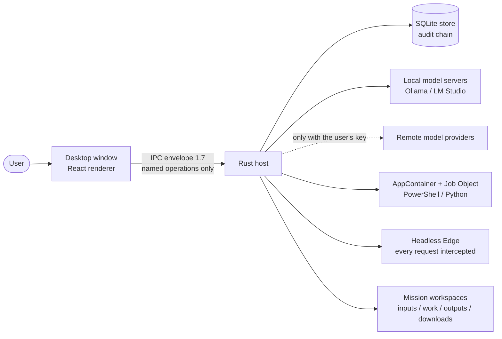
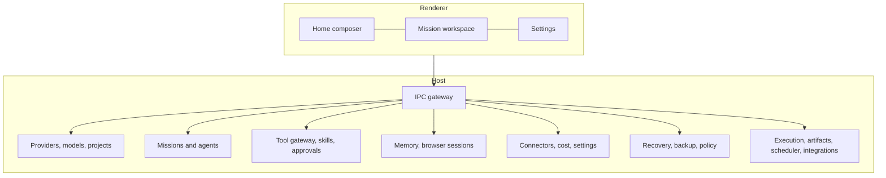
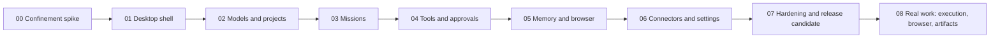

# بولاريس — نظرة عامة

[English](../en/01-overview.md)

بولاريس بيئة عمل مكتبية محلية أولًا لنظام ويندوز، يؤدّي فيها وكلاء الذكاء الاصطناعي عملًا حقيقيًا — تشغيل شيفرة، واستعمال متصفّح، وإنتاج مستندات — تحت ضوابط يراها المستخدم: كل فعل يمرّ ببوابة واحدة، وكل ما فيه خطر ينتظر المستخدم، وكل نتيجة تحمل دليلها.

كل مخطّط أدناه موسوم بحالته: **IMPLEMENTED** (مبني ومقيس)، أو **FOUNDATION_ONLY** (البنية موجودة والميزة الكاملة ليست كذلك)، أو **PLANNED** أو **NOT_IMPLEMENTED**. لا شيء هنا يدّعي أكثر من ذلك.

ما ليس عليه بولاريس اليوم: ليس موقّعًا، ولم يُصدَر للعموم، وليس متاحًا على macOS، ولم يُقارَن بأي منتج آخر.

## سياق النظام

الحالة: **IMPLEMENTED**

## خريطة المكوّنات

الحالة: **IMPLEMENTED**

## المراحل المُنجزة

الحالة: **IMPLEMENTED**

