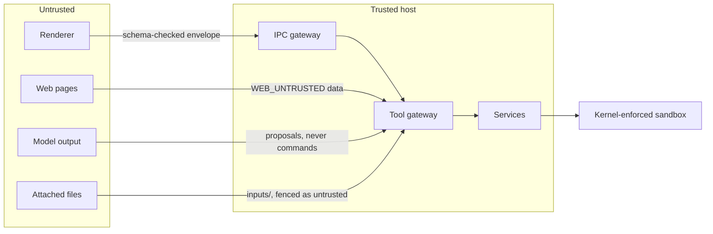
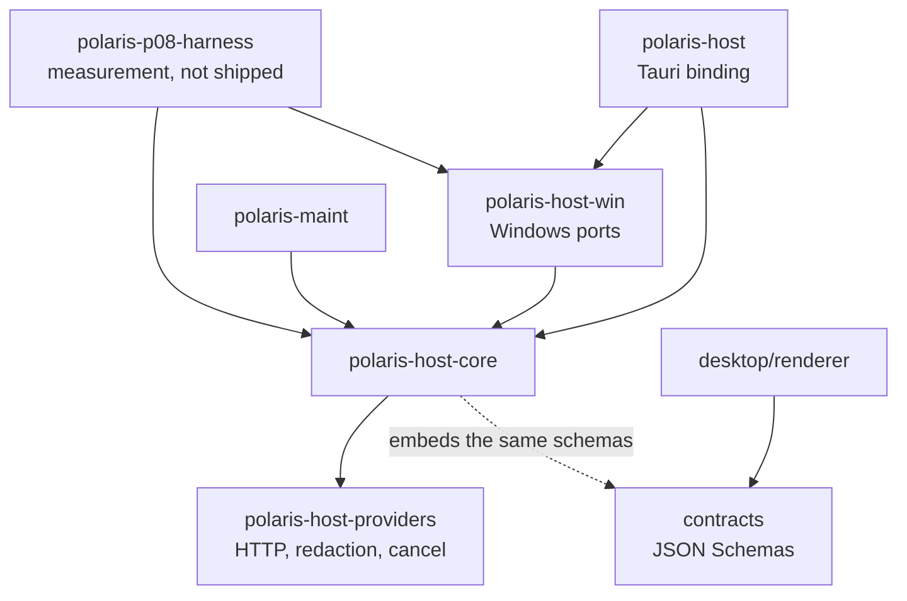
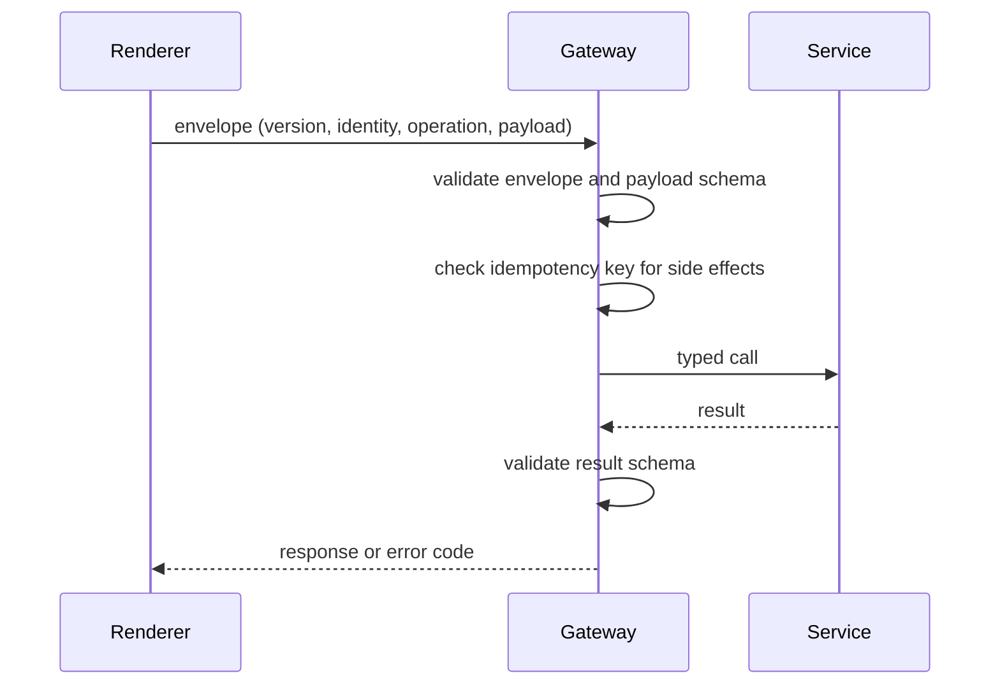
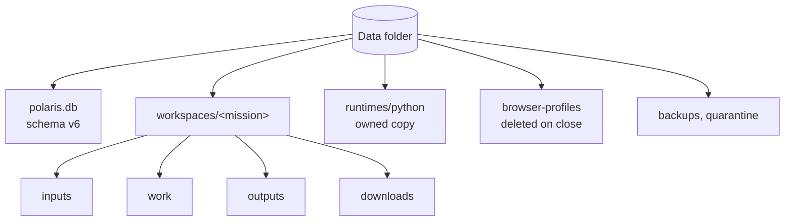

# المعمارية

[English](../en/02-architecture.md)

العارض (React داخل نافذة WebView2) غير موثوق عمدًا: لا يستطيع إلا إرسال عمليات مسمّاة داخل ظرف بإصدار، والمضيف يتحقّق من كل حمولة وكل نتيجة بمخطّطات JSON يتشاركها مع حزمة العقود. المضيف مساحة عمل Rust؛ والشيفرة الخاصّة بويندوز في حزمة مستقلّة كي تبقى النواة قابلة للنقل والاختبار على أي نظام.

## حدود الثقة

الحالة: **IMPLEMENTED**

## الحزم

الحالة: **IMPLEMENTED**

## نداء IPC واحد

الحالة: **IMPLEMENTED**

## تخطيط البيانات المحلية

الحالة: **IMPLEMENTED**

