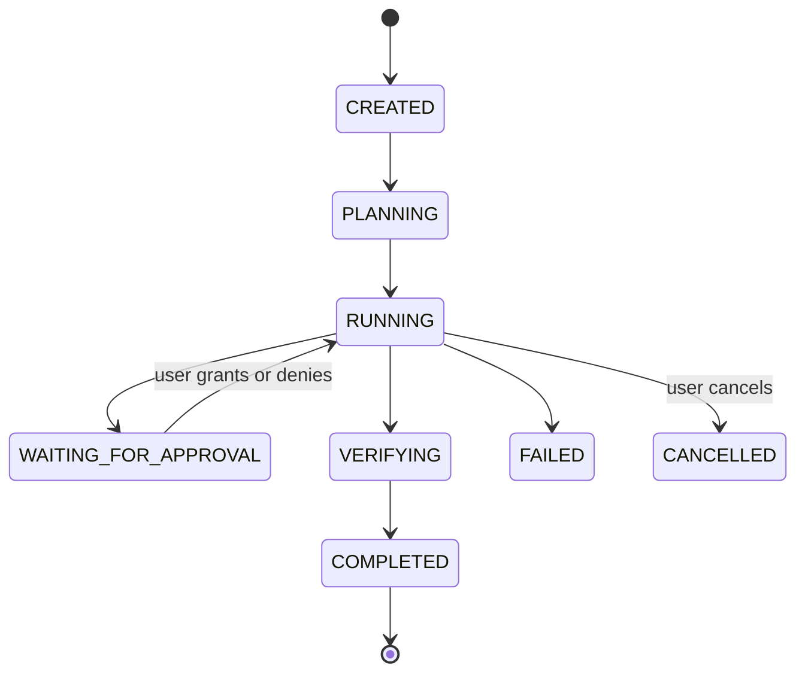
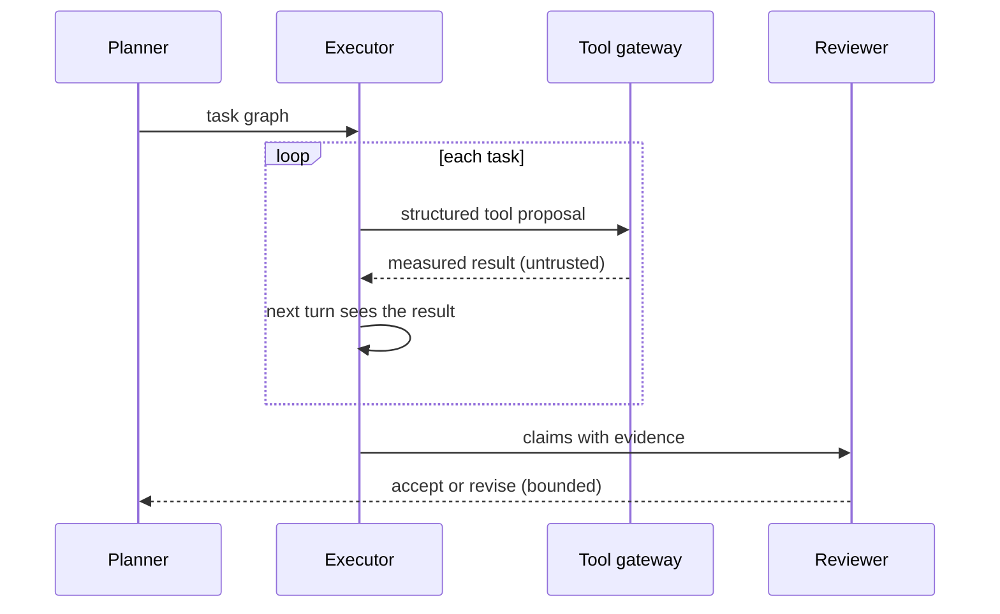
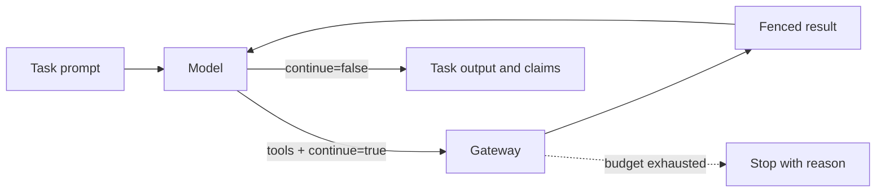
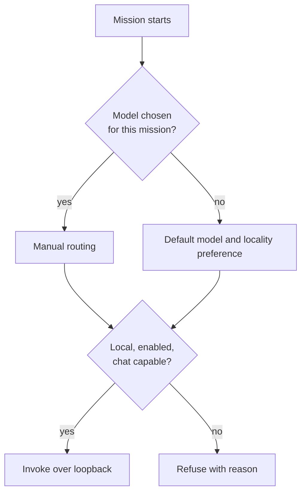

# المهامّ والوكلاء

[English](../en/03-missions.md)

المهمّة هي ما يطلبه المستخدم. يحوّلها المخطِّط إلى رسم مهامّ صغير، وينفّذ المنفّذ كل مهمّة على جولات — يرى النتيجة المقيسة لكل أداة قبل الجولة التالية — ويتحقّق المراجع من الادّعاءات مقابل أدلّتها. المحاولات والمراجعات محدودة العدد. يُختار النموذج لكل مهمّة؛ النماذج المحلية عبر الحلقة المحلية، والبعيدة فقط حين يضيف المستخدم مفتاحه.

## حالات المهمّة

الحالة: **IMPLEMENTED**

## خطّط، نفّذ، راجع

الحالة: **IMPLEMENTED**

## حلقة الأدوات متعدّدة الجولات

الحالة: **IMPLEMENTED**

## توجيه النماذج

الحالة: **IMPLEMENTED**

