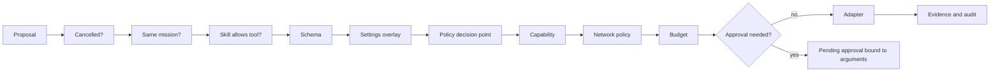
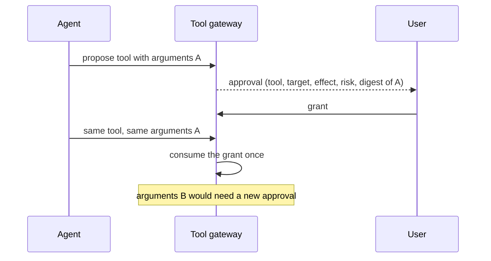
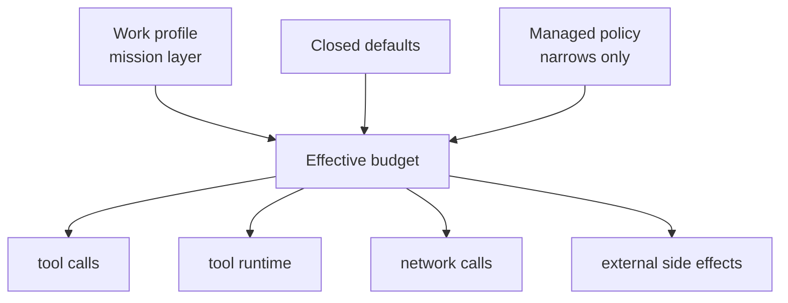

# الأدوات والموافقات

[English](../en/04-tools-and-approvals.md)

الوكلاء لا يتصرّفون مباشرة. يقترحون نداء أداة؛ وتفحصه بوابة الأدوات خطوة خطوة، فإمّا تنفّذه، أو ترفضه بسبب، أو تحوّله إلى موافقة يراها المستخدم. الموافقة مربوطة بالحجج نفسها: حجّة تتغيّر طلبٌ جديد. الميزانيات تحدّ ما تستطيعه المهمّة؛ والسياسة المُدارة تضيّقها ولا توسّعها أبدًا.

## مسار بوابة الأدوات

الحالة: **IMPLEMENTED**

## موافقة مربوطة بالحجج

الحالة: **IMPLEMENTED**

## ميزانيات المهمّة

الحالة: **IMPLEMENTED**

