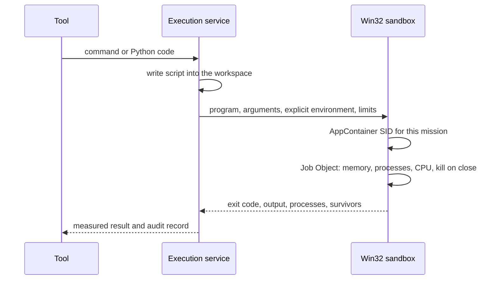
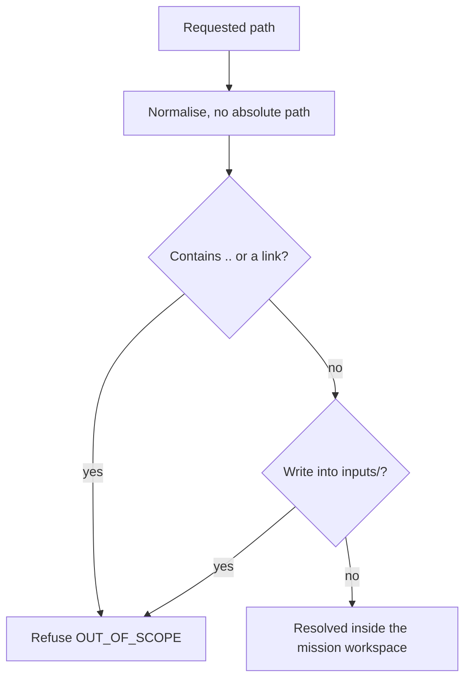
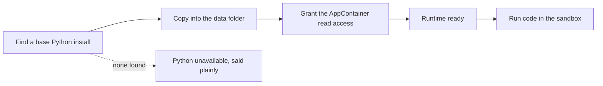

# تشغيل الشيفرة

[English](../en/05-execution.md)

الأوامر (Windows PowerShell) وPython تعمل داخل AppContainer خاصّ بالمهمّة وكائن مهمّة: لا وصول إلى ملفات المستخدم، ولا شبكة إلا بتشغيل موافَق عليه، وحدود للذاكرة والعمليات والمعالج، وكل عملية فرعية تنتهي مع كائن المهمّة. تثبيت الحزم واستعمال الشبكة وتغيير النظام وتشغيل الملفات المنزّلة تنتظر المستخدم دائمًا. يعمل Python من نسخة مملوكة يُعدّها بولاريس عند الطلب.

## تشغيل داخل الصندوق

الحالة: **IMPLEMENTED**

## حصر مساحة العمل

الحالة: **IMPLEMENTED**

## بيئة Python

الحالة: **IMPLEMENTED**

