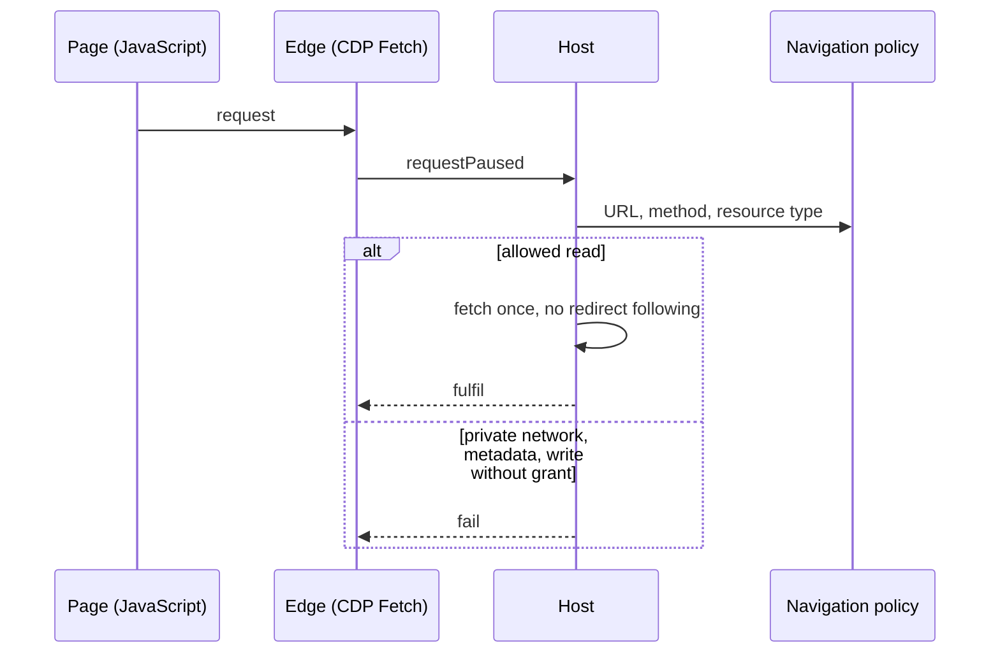
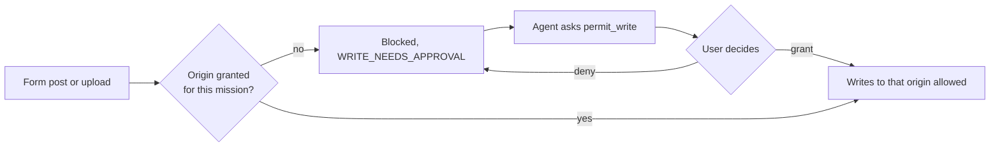

# المتصفّح الحقيقي

[English](../en/06-browser.md)

لكل مهمّة متصفّح Microsoft Edge بلا واجهة وبملف تعريف مؤقّت. يعمل جافاسكربت فتعمل المواقع الحديثة، لكن كل طلب تُطلقه الصفحة يُوقَف ويحكم عليه المضيف: الشبكات الخاصّة وعناوين البيانات الوصفية السحابية مرفوضة، وإعادة التوجيه لا تُتبع عمياء، وإرسال البيانات (النماذج والرفع) يحتاج موافقة لكل موقع. حقول كلمات المرور لا يُكتب فيها أبدًا. التنزيلات تذهب إلى مجلد عزل ولا تُفتح. وما تقوله الصفحة يصل الوكيل موسومًا بيانات ويب غير موثوقة.

## كل طلب يُعترَض

الحالة: **IMPLEMENTED**

## إرسال البيانات يحتاج إذنًا

الحالة: **IMPLEMENTED**

