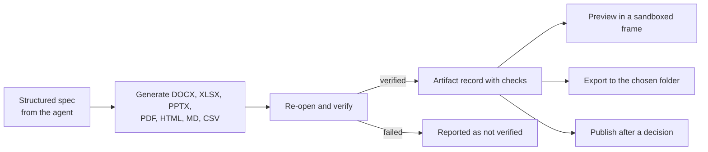

# المخرجات

[English](../en/07-artifacts.md)

ينتج الوكلاء ملفات Word وExcel (بمخطّطات) وPowerPoint وPDF (ومنها العربية بخط مضمَّن) وHTML وMarkdown وCSV وصورًا وشيفرة. يكتب بولاريس هذه الصيغ بنفسه ويعيد فتح كل ملف للتحقّق منه قبل الإعلان عنه؛ ويرافق التحقّقُ المخرَج. المعاينة داخل إطار معزول بلا نصوص برمجية. والتصدير إلى مجلد اختاره المستخدم دون كتابة فوق ملف.

## مسار المخرجات

الحالة: **IMPLEMENTED**

