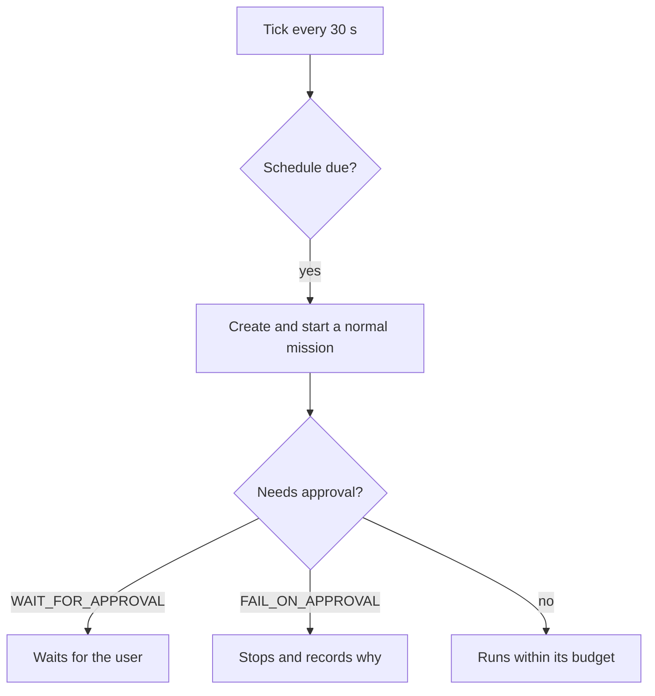
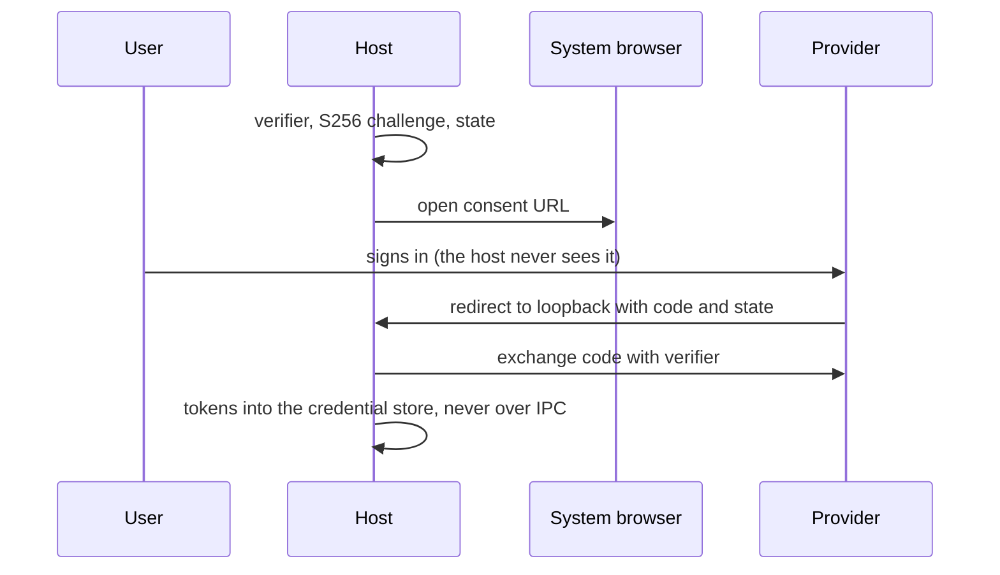
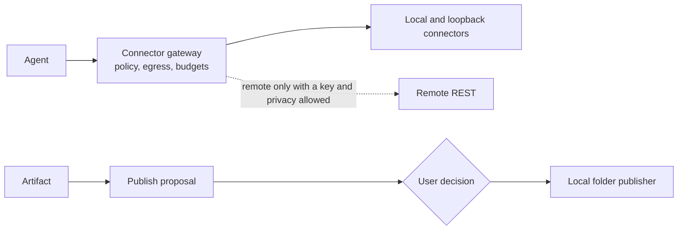

# الجداول والتكاملات

[English](../en/08-scheduler-integrations.md)

الجدول يبدأ مهمّة عادية؛ ولا يحمل موافقة ممنوحة سلفًا. يستعمل OAuth متصفّح النظام مع PKCE وإعادة توجيه إلى الحلقة المحلية، وتبقى الرموز في مخزن اعتماد نظام التشغيل — لم يُقس تسجيل دخول حقيقي لدى مزوّد بعد، فهذا أساس. الموصلات والنشر تمرّ بالبوابة نفسها؛ والناشر الوحيد المبني اليوم يكتب في مجلد محلي بعد قرار.

## المهامّ المجدولة

الحالة: **IMPLEMENTED**

## OAuth 2.0 مع PKCE

الحالة: **FOUNDATION_ONLY**

## الموصلات والنشر

الحالة: **FOUNDATION_ONLY**

