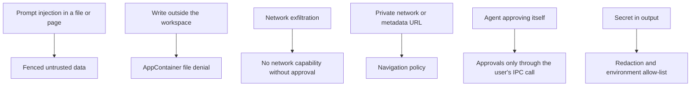
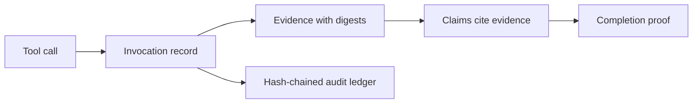

# النموذج الأمني

[English](../en/09-security.md)

مخرجات النموذج وصفحات الويب والملفات المرفقة بيانات لا تعليمات. والذاكرة سياق لا مرتكز ثقة. العارض لا يستطيع تنفيذ شيء. كل نداء أداة يُسجَّل بخلاصاته في سجلّ تدقيق مسلسل التجزئة، ولا تكتمل مهمّة إلا بإثبات مبني من أدلّتها. والقياسات التي تعذّرت تُعلن NOT_TESTED أو BLOCKED مع السبب، ولا تُعلن ناجحة أبدًا.

## أين يتوقّف كل تهديد

الحالة: **IMPLEMENTED**

## الأدلّة والتدقيق

الحالة: **IMPLEMENTED**

