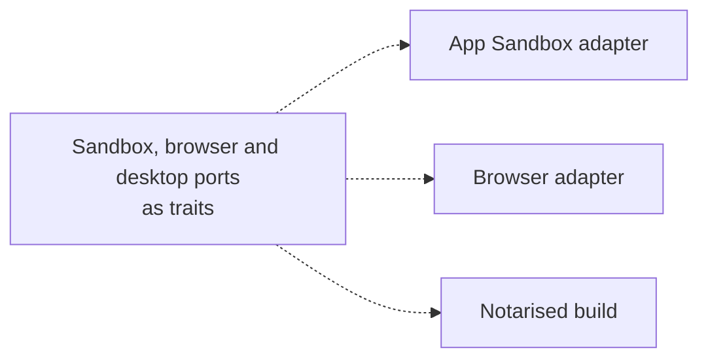
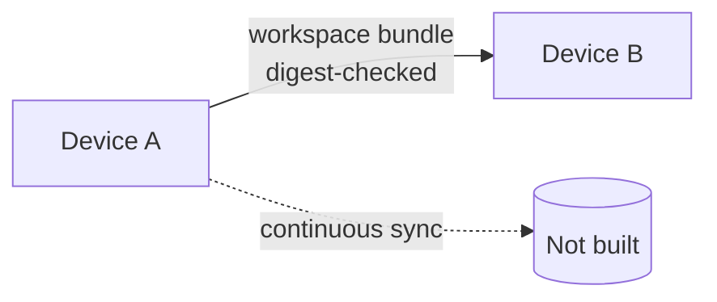
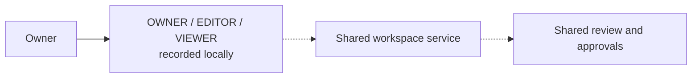

# ما لم يُبنَ بعد

[English](../en/10-roadmap.md)

هذه المخطّطات تصف اتجاهًا لا ميزات. لنظام macOS منافذ بلا محوّلات. نقل مساحة العمل بين الأجهزة يعمل حزمةً مُتحقَّقًا من خلاصتها؛ والمزامنة المستمرّة غير موجودة. أدوار التعاون تُسجَّل محليًا؛ ولا خدمة مشتركة.

## محوّلات macOS

الحالة: **NOT_IMPLEMENTED**

## عدّة أجهزة

الحالة: **FOUNDATION_ONLY**

## التعاون

الحالة: **PLANNED**

