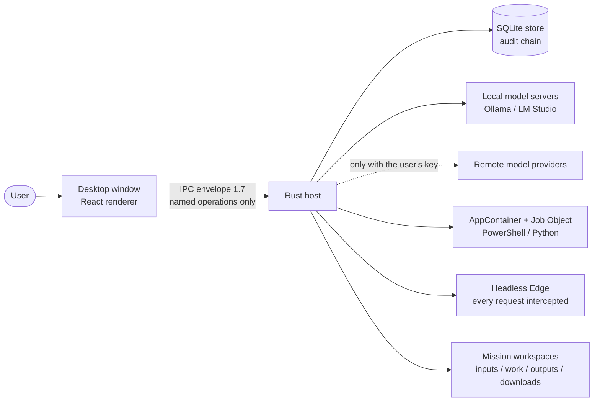
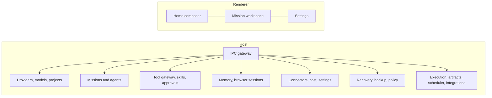
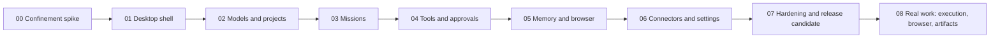

# POLARIS — overview

[العربية](../ar/01-overview.md)

POLARIS is a local-first desktop work environment for Windows in which AI agents do real work — run code, use a browser, produce documents — under controls the user can see: every action passes one gateway, anything risky waits for the user, and every result carries its evidence.

Each diagram below carries a status label: **IMPLEMENTED** (built and measured), **FOUNDATION_ONLY** (the structure exists, the full feature does not), **PLANNED** or **NOT_IMPLEMENTED**. Nothing here claims more than that.

What POLARIS is not, today: it is not signed, not released publicly, not available on macOS, and it has not been compared with any other product.

## System context

Status: **IMPLEMENTED**

## Component map

Status: **IMPLEMENTED**

## Phases delivered

Status: **IMPLEMENTED**

