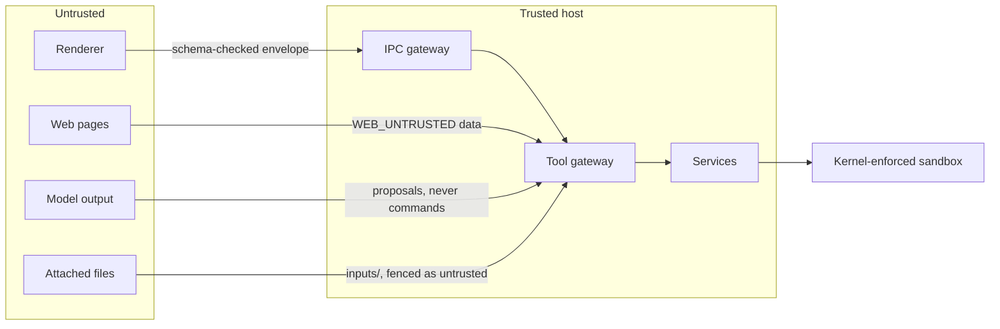
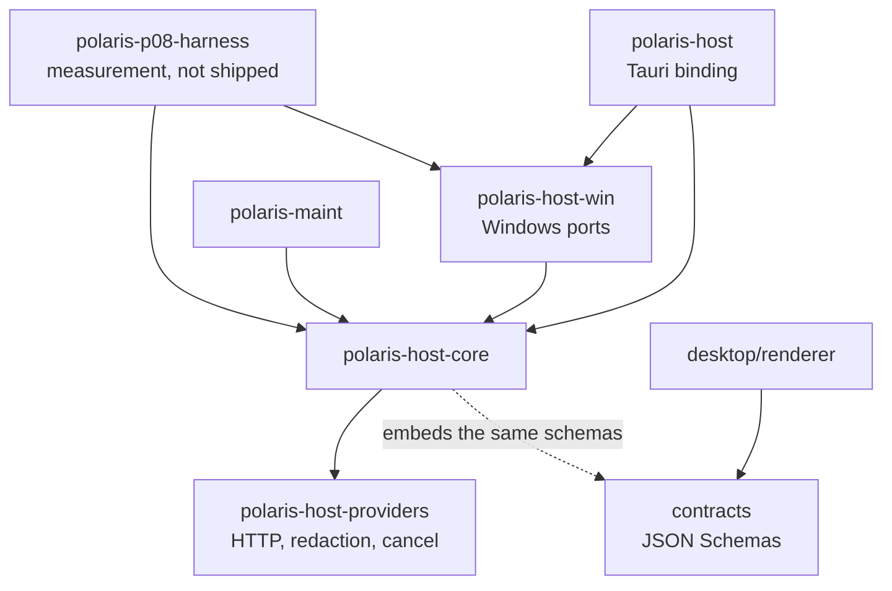
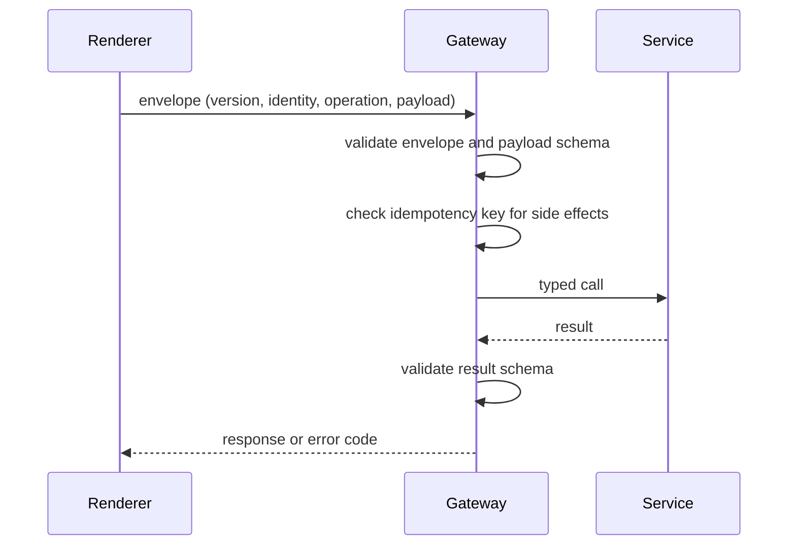
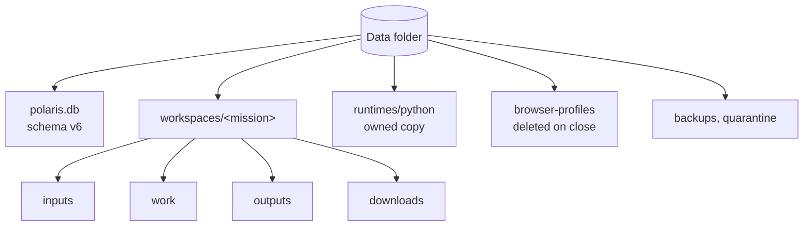

# Architecture

[العربية](../ar/02-architecture.md)

The renderer (React in a WebView2 window) is untrusted by design: it can only send named operations in a versioned envelope, and the host validates every payload and every result against JSON Schemas shared with the contracts package. The host is a Rust workspace; Windows-specific code lives in its own crate so that the core stays portable and testable on any system.

## Trust boundaries

Status: **IMPLEMENTED**

## Crates and packages

Status: **IMPLEMENTED**

## One IPC call

Status: **IMPLEMENTED**

## Local data layout

Status: **IMPLEMENTED**

