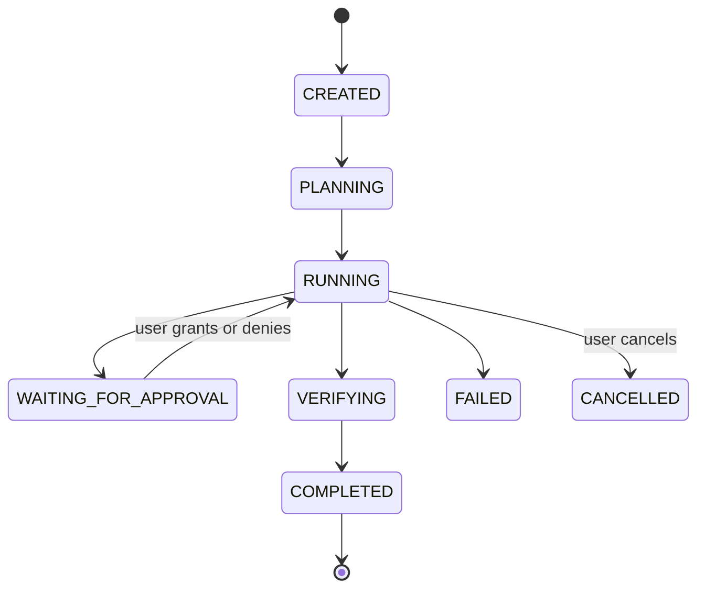
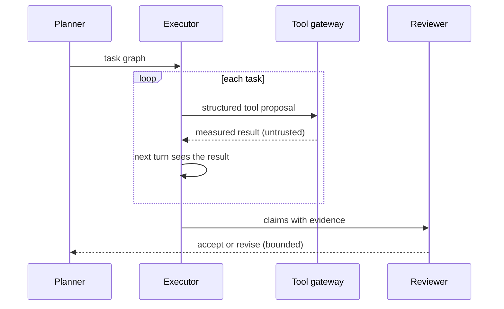
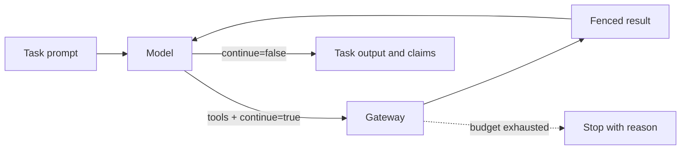
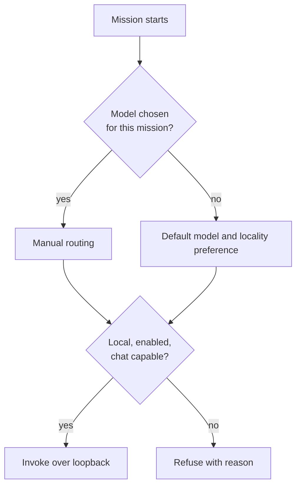

# Missions and agents

[العربية](../ar/03-missions.md)

A mission is what the user asks for. A planner turns it into a small task graph, an executor works through each task over several turns — seeing the measured result of each tool call before the next — and a reviewer checks the claims against their evidence. Retries and revisions are bounded. The model is chosen per mission; local models are used over loopback, remote ones only when the user has added a key.

## Mission states

Status: **IMPLEMENTED**

## Plan, act, review

Status: **IMPLEMENTED**

## Multi-turn tool loop

Status: **IMPLEMENTED**

## Model routing

Status: **IMPLEMENTED**

