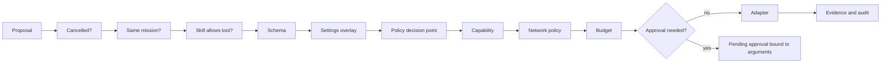
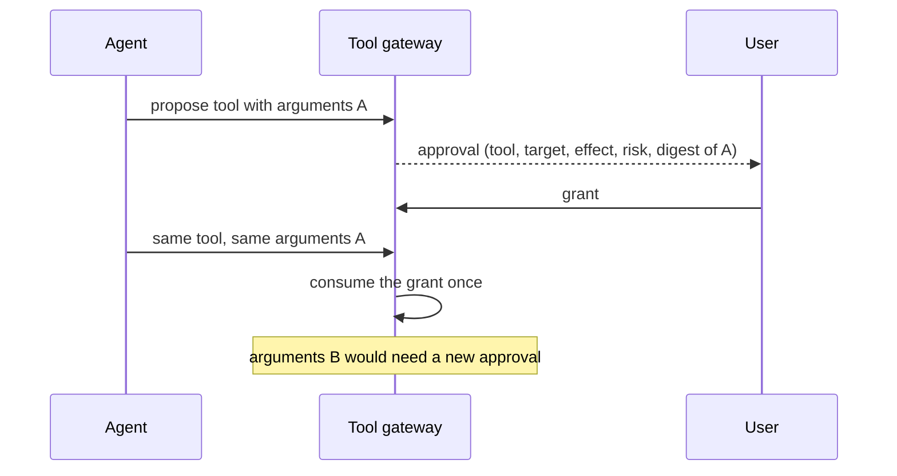
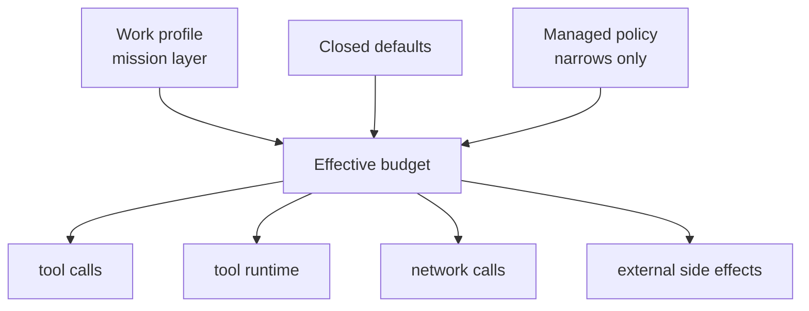

# Tools and approvals

[العربية](../ar/04-tools-and-approvals.md)

Agents never act directly. They propose a tool call; the tool gateway checks it step by step and either runs it, refuses it with a reason, or turns it into an approval the user sees. An approval is bound to the exact arguments: a changed argument is a new request. Budgets bound how much a mission can do; a managed policy can narrow them but never widen them.

## Tool gateway pipeline

Status: **IMPLEMENTED**

## Approval bound to arguments

Status: **IMPLEMENTED**

## Mission budgets

Status: **IMPLEMENTED**

