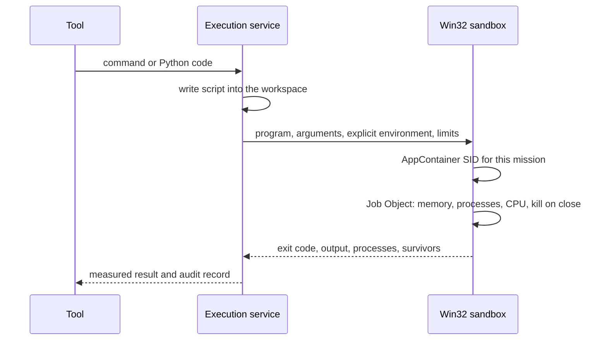
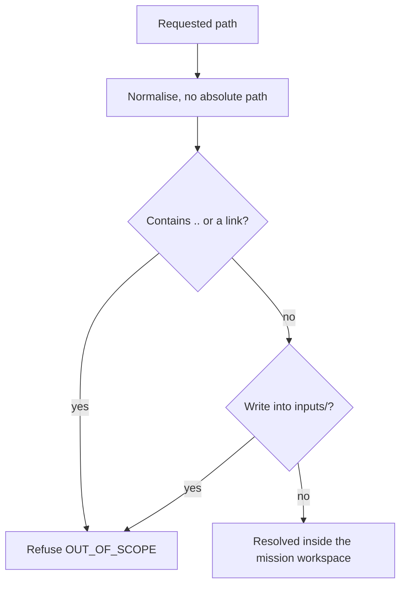
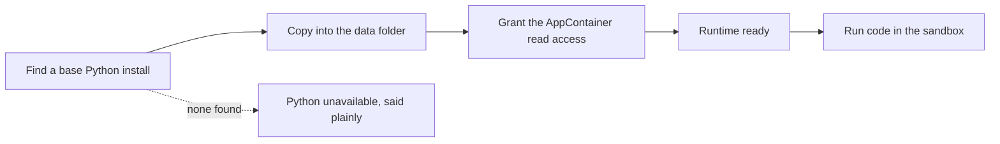

# Code execution

[العربية](../ar/05-execution.md)

Commands (Windows PowerShell) and Python run inside the mission's own AppContainer and a Job Object: no access to the user's files, no network unless an approved run adds it, limits on memory, processes and CPU, and every child process ends with the job. Package installs, network use, system changes and running downloaded files always wait for the user. Python runs from an owned copy that POLARIS prepares on request.

## Sandboxed run

Status: **IMPLEMENTED**

## Workspace confinement

Status: **IMPLEMENTED**

## Python runtime

Status: **IMPLEMENTED**

