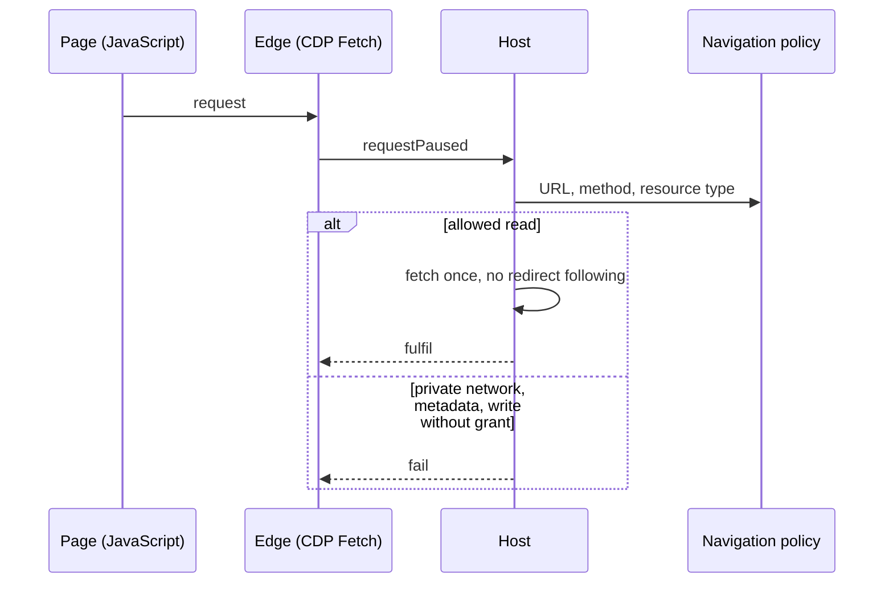
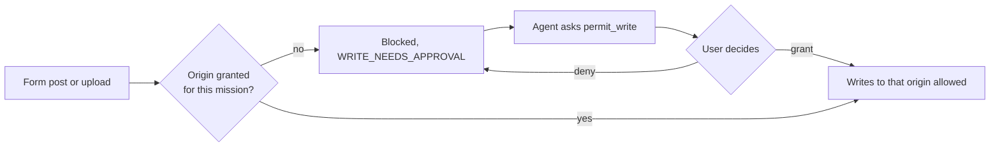

# The real browser

[العربية](../ar/06-browser.md)

Each mission gets a headless Microsoft Edge with a throw-away profile. JavaScript runs, so modern sites work, but every request the page makes is paused and judged by the host: private networks and cloud metadata addresses are refused, redirects are not followed blindly, and sending data (forms, uploads) needs a per-site approval. Password fields are never typed into. Downloads go to a quarantine folder and are never opened. What the page says reaches the agent labelled as untrusted web data.

## Every request intercepted

Status: **IMPLEMENTED**

## Sending data needs a grant

Status: **IMPLEMENTED**

