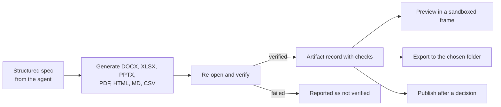

# Artifacts

[العربية](../ar/07-artifacts.md)

Agents produce Word, Excel (with charts), PowerPoint, PDF (including Arabic with an embedded font), HTML, Markdown and CSV files, images and code. POLARIS writes these formats itself and re-opens every file to verify it before reporting it; the verification travels with the artifact. Previews run in a sandboxed frame with scripts off. Exports go to a folder the user chose, never overwriting.

## Artifact pipeline

Status: **IMPLEMENTED**

