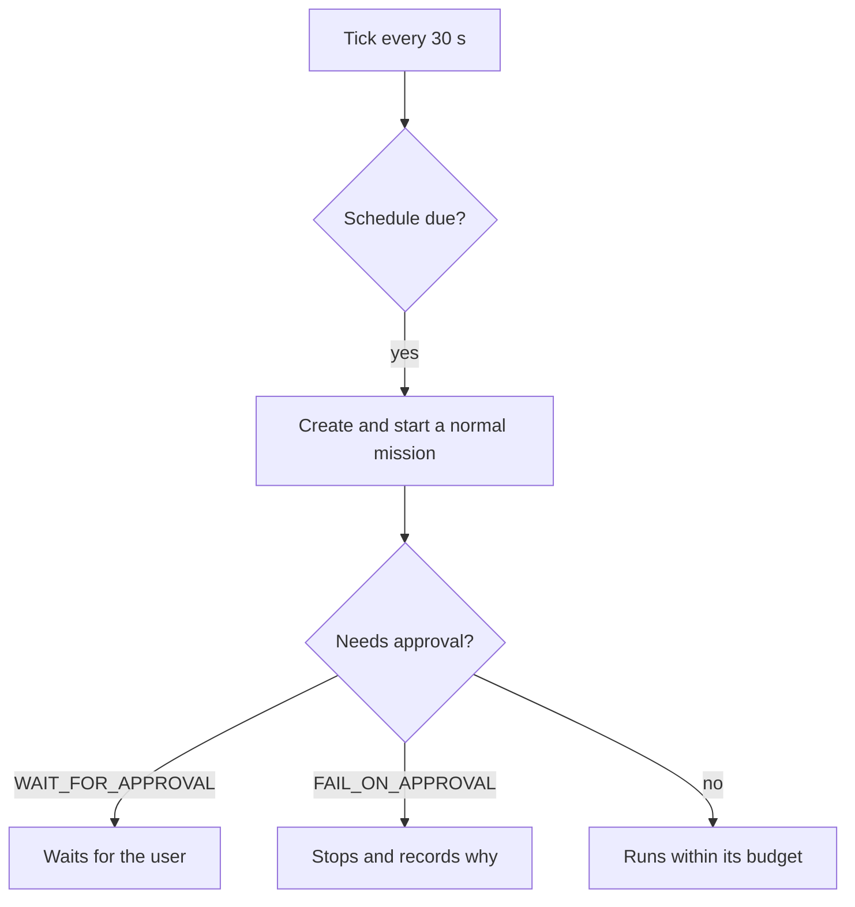
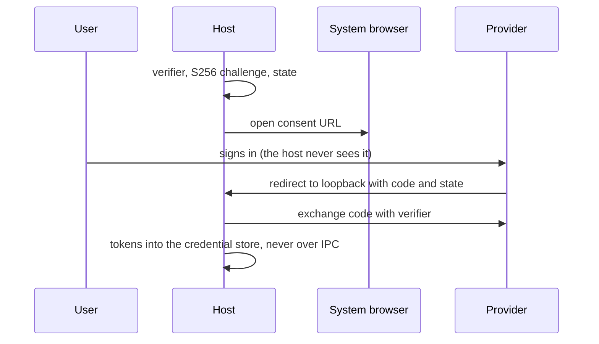
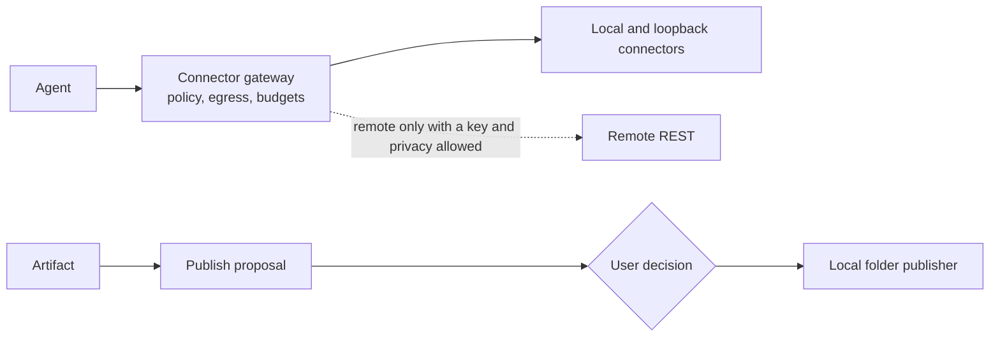

# Schedules and integrations

[العربية](../ar/08-scheduler-integrations.md)

A schedule starts an ordinary mission; it never carries a pre-granted approval. OAuth uses the system browser with PKCE and a loopback redirect, and tokens stay in the operating system's credential store — no live provider login has been measured yet, so this is a foundation. Connectors and publishing pass the same gateway; the only publisher built today writes to a local folder after a decision.

## Scheduled missions

Status: **IMPLEMENTED**

## OAuth 2.0 with PKCE

Status: **FOUNDATION_ONLY**

## Connectors and publishing

Status: **FOUNDATION_ONLY**

