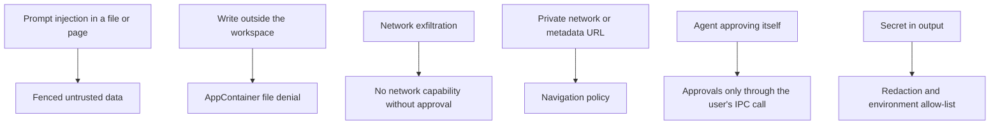
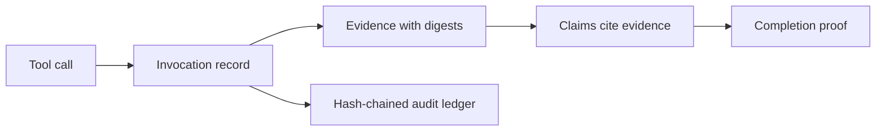

# Security model

[العربية](../ar/09-security.md)

Model output, web pages and attached files are data, never instructions. Memory is context, never a trust anchor. The renderer cannot execute anything. Every tool call is recorded with digests in a hash-chained audit ledger, and a mission completes only with a proof built from its evidence. Measurements that could not be made are reported as NOT_TESTED or BLOCKED with the reason, never as passed.

## Where each threat stops

Status: **IMPLEMENTED**

## Evidence and audit

Status: **IMPLEMENTED**

