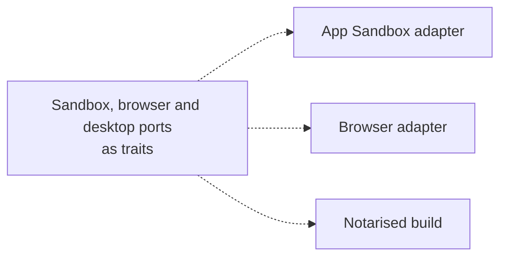
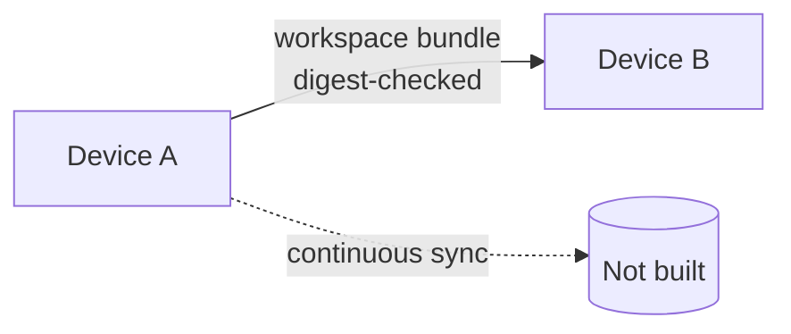
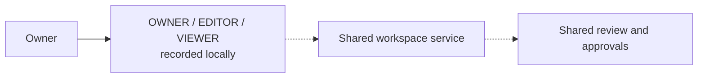

# What is not built yet

[العربية](../ar/10-roadmap.md)

These diagrams describe direction, not features. macOS has ports but no adapters. Moving a workspace between devices works as a digest-checked bundle; continuous sync does not exist. Collaboration roles are recorded locally; there is no shared service.

## macOS adapters

Status: **NOT_IMPLEMENTED**

## Several devices

Status: **FOUNDATION_ONLY**

## Collaboration

Status: **PLANNED**

